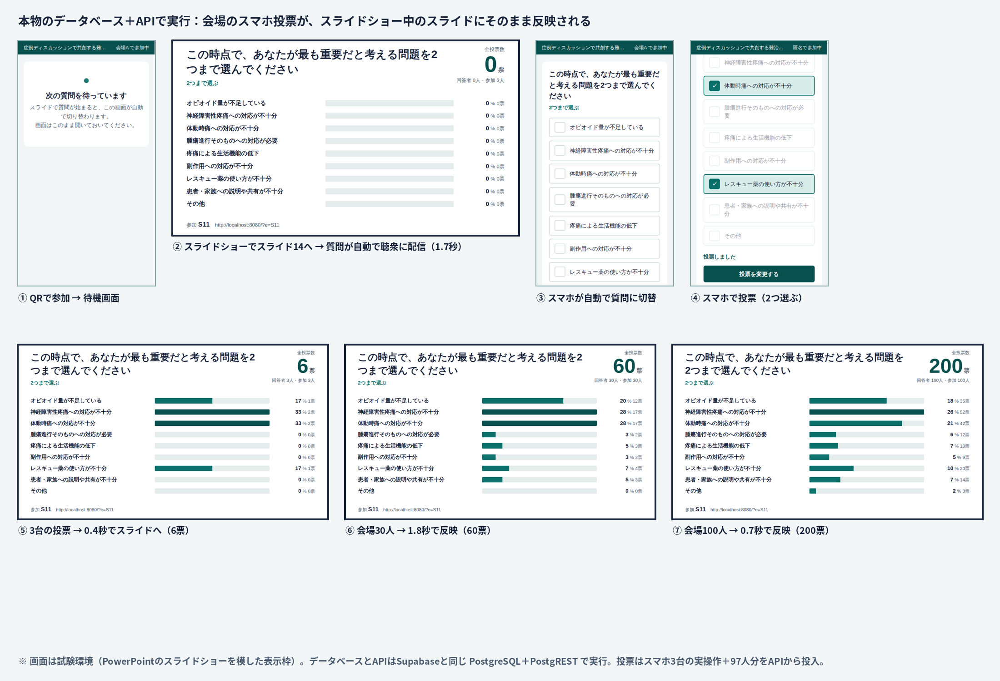

# リアルタイム投票システム（Slido 代替・自前運用版）

会場の聴衆がQRコードからスマートフォンで投票し、その結果が **スライドショー中のPowerPointのスライドにそのまま（約2秒ごとに）反映** される仕組みです。
GitHub（プログラムの公開）＋ Supabase（データベース・ログイン）で動き、サーバーの用意は不要です。

## 説明書
| 読む人 | 文書 |
|---|---|
| スライドを作る先生方（共同編集者） | [docs/MANUAL_PPT.md](docs/MANUAL_PPT.md) |
| 導入する人・メイン編集者 | [docs/SETUP_ADMIN.md](docs/SETUP_ADMIN.md) |
| しくみを知りたい人 | [docs/ARCHITECTURE.md](docs/ARCHITECTURE.md) |

## 導入の流れ（概要）
1. Supabase で `supabase/01_schema.sql` を実行（何度実行しても既存データは消えない）
2. このフォルダを GitHub リポジトリにアップロード
3. リポジトリ変数 `SUPABASE_URL` と `SUPABASE_ANON_KEY` を登録し、Pages の公開元を「GitHub Actions」にする → 自動で公開
4. 管理画面で新規登録 →「プロジェクトを作成」（作成者がメイン編集者。共同編集者に伝えるパスワードを決める）
5. **プロジェクト番号とパスワード** と、アドイン配布ページ（`install.html`）のURLを共同編集者に伝える（メイン編集者と共同編集者の編集範囲は同じ）

詳しくは [docs/SETUP_ADMIN.md](docs/SETUP_ADMIN.md)。

## ファイル構成
| ファイル | 役割 |
|---|---|
| `index.html` | 聴衆の参加・投票画面（QRコードから開く） |
| `projector.html` | 結果の投影画面（スライドの窓の中身／ブラウザ全画面の予備） |
| `addin.html` | PowerPoint アドイン（質問の作成支援・デザイン設定・スライドショー連動） |
| `admin.html` | 管理画面（プロジェクトの作成・参加、編集者、デザイン、進行、締切、リセット、CSV） |
| `install.html` | PowerPoint アドイン配布ページ（ログインした編集者に Windows 用インストーラー／Mac 用設定ファイルを生成） |
| `assets/` | 共通部品（集計表示・配色・背景・QR）と同梱ライブラリ（supabase-js 2.45.4、qrcode-generator 1.4.4、いずれも MIT） |
| `supabase/01_schema.sql` | データベース定義・権限・関数 |
| `supabase/02_seed_symposium11.sql` | シンポジウム11のサンプル質問（任意） |
| `.github/workflows/deploy.yml` | GitHub への push で自動公開 |
| `tools/build.py` | 公開時に `config.js` を作る |
| `manifest.example.xml` | アドイン設定ファイルの見本（実物は `install.html` が作る） |
| `config.js` | 接続設定（公開時に自動で上書きされる。手元で試すときだけ編集） |

## 投票の種類
選択式（単一・複数／回答者による選択肢の追加）、ワードクラウド、自由意見、クイズ、ランキング、評価（星）、会場からの質問（Q&A）、アイデア募集、参加案内スライド。

## 集計の定義
- **全投票数**：選択肢に入った票の合計。選択式（単一・複数）・クイズ・評価では、投影画面の右上に大きく表示する（その下に回答者数と参加者数）。
- **割合（％）**：各選択肢の票数 ÷ 全投票数。複数選択でも合計は100％になる。選択肢を作り込む形式（選択式・クイズ・評価）では、**割合と件数を必ず同時に表示**する（表示の切替はしない）。
- **回答者数**：その質問に1回以上投票した参加者の数。
- 横棒の長さは、最も票の多い選択肢を最大として描く。
- **自動調整**：投影の枠にすべての選択肢が入るよう、文字と行間を自動で縮める（最小で約半分の大きさ）。回答者が選択肢を大量に追加して最小でも入らない場合は、票の多い順に入るだけ表示し、残りを「ほか n 項目（計 m 票・x％）」として1行にまとめる。
- 順位付け：上位K個に順位をつける方式。得点は 1位＝K点 … K位＝1点（ボルダ得点）。得点順に並べ、各選択肢を1位に選んだ人数も示す。
- 評価（星）：平均点（小数1桁）と、星の数ごとの割合・票数を表示する。
- クイズ：正解は「正解を出す」まで聴衆にも投影画面にも送られない（データベース側で伏せている）。
- 自由記載のワードクラウド：全角半角・空白・句読点の違いを寄せて同じ回答をまとめ、件数に応じて文字を大きくする（形態素解析はしていないため、短い言葉での回答を促している）。

## 上限
| 項目 | 上限 | 備考 |
|---|---|---|
| 作成者が作る選択肢 | 10件 | データベース側でも11件目を拒否する |
| 複数選択で選べる数 | 10件 | データベース側でも制限 |
| 回答者が追加する選択肢 | なし | 選択式で「回答者による選択肢の追加」を許可した場合。1件40文字まで。同じ文言（空白の違いは無視）は同じ選択肢として扱う。追加された選択肢はほかの回答者も選べ、投影では「追加」の印が付く。票を消去すると、追加された選択肢も消える |

## デザイン
- 配色8種（ティール／ネイビー／スカイ／フォレスト／ワイン／オレンジ／パープル／グレー）。プロジェクトの既定を管理画面で決め、スライドごとに変更可。
- 背景：白／濃紺／透明（PowerPoint のスライド背景を生かす）／画像（アップロード時に自動縮小。文字を読みやすくする「白く薄める／暗く沈める」付き）。
- 参加用QRコード：1枚目の参加案内スライドに大きく、または各質問スライドの右下にも表示。

## データの取扱い
- 聴衆から取得するのはニックネーム（本名でも可。既定で必須）と回答のみ。ニックネームは管理画面にのみ表示され、投影画面には出ない。
- 投影用の鍵はアドインの設定としてPowerPointファイル内に保存される。スライドファイルを外部配布する場合は、アドインの枠を削除してから配布する（またはPDFにして配布する）。
- 会の終了後、CSVを保存したうえで、不要になったセッションのデータは Supabase の Table Editor から削除できる。

## ライセンス
- 本リポジトリ独自のプログラム・文書：`LICENSE` のとおり（著作権者の許諾がない複製・改変・再配布は不可）。
- 同梱ライブラリ（supabase-js、qrcode-generator）：いずれも MIT ライセンス。`THIRD_PARTY_NOTICES.md` を参照。
