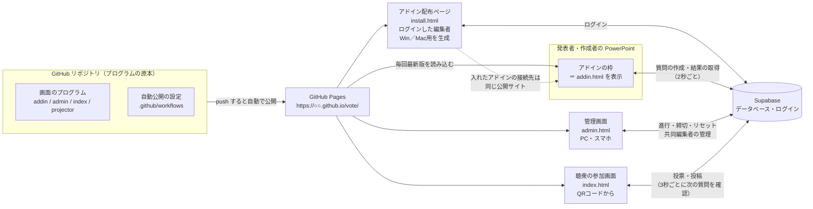

# 全体構成：PowerPoint・GitHub・データベースはどうつながっているか

## 結論
プログラムの本体（メインフレーム）は **1つ** です。PowerPoint のアドイン、管理画面、聴衆の参加画面、投影画面は、すべて GitHub Pages に置いた同じプログラムの「別の画面」で、同じデータベース（Supabase）と同じログインを共有しています。

## それぞれの役割
| 部品 | 役割 | 置き場所 |
|---|---|---|
| GitHub リポジトリ | プログラムの原本と更新履歴。push すると自動で公開される | GitHub |
| GitHub Pages | 画面（プログラム）を配る場所。データは持たない | GitHub |
| Supabase | 質問・票・投稿・プロジェクト・アカウントを保存し、権限を判定する | Supabase |
| PowerPoint アドイン | スライドの中に GitHub Pages の画面を表示する「窓」。質問づくりの支援と、スライドショー中の結果表示を行う | 各PCに登録（設定ファイル1つ） |

## アドインの配布（Windows／Mac）
- 配布ページ `install.html` は、ログインした人にダウンロードを表示します。
- Windows 用：インストーラー（`install-vote-addin.cmd`）。アドインの設定ファイルを `%LOCALAPPDATA%\SymposiumVote` に保存し、PowerPoint にアドインの場所を登録します（ユーザー単位・管理者権限不要）。
- Mac 用：設定ファイル（`vote-addin.xml`）を PowerPoint の所定フォルダ（`~/Library/Containers/com.microsoft.Powerpoint/Data/Documents/wef`）に置きます。
- どちらも、中に書かれている接続先は **配布ページと同じ公開サイト**（`…/addin.html`）です。つまり、入れたアドインは自動的に同じメインフレームにつながります。

## 「PowerPoint と Git の接続」の意味
- PowerPoint は Git（GitHub）を直接操作しません。アドインの設定ファイル（`manifest.xml`）が「GitHub Pages の `addin.html` を開く」ことを PowerPoint に伝えているだけです。
- そのため、**GitHub のプログラムを更新すると、全員の PowerPoint の中のアドインが次に開いたときから新しくなります**（入れ直し不要）。
- 作成支援（質問の作成、スライドの文字の読み取り、デザイン設定、Q&A の選択）は、このアドインの中で行います。作った質問はデータベースに保存され、管理画面や他の共同編集者の PowerPoint からも同じものが見えます。

## アクセス（権限）の連動
| 誰が | ログイン | 見える・できる範囲 |
|---|---|---|
| 全体管理者（任意） | メール＋パスワード | すべてのプロジェクト |
| メイン編集者・共同編集者 | メール＋パスワード（同じアカウントで配布ページ・管理画面・アドインを使う） | 作成した、または**プロジェクト番号＋プロジェクトのパスワード**で参加したプロジェクトだけ（編集できる範囲は同じ） |
| 投影画面（スライドの窓） | 不要（プロジェクトごとの投影用の鍵を使う） | そのプロジェクトの結果の表示と、質問の切り替えだけ |
| 聴衆 | 不要（参加コード＋ニックネーム） | 投票・投稿、自分の回答の確認だけ |

権限の判定はすべてデータベース側（行単位の権限設定と関数）で行っています。画面を書き換えても、権限を越えた読み書きはできません。

## データの流れ（本番中）
1. 発表者がスライドショーで投票スライドに進む → 枠がデータベースに「この質問を表示」と書き込む
2. 聴衆のスマートフォンが3秒以内にそれを読み取り、質問画面に切り替わる
3. 聴衆が投票 → データベースに保存
4. 枠が2秒ごとに集計を読み取り、棒グラフと全投票数を描き直す
