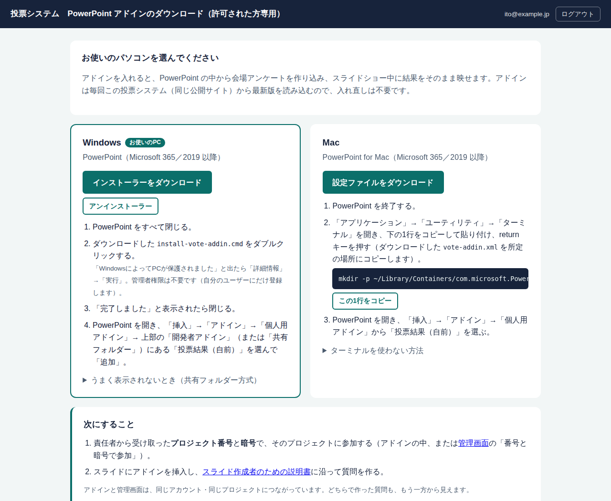
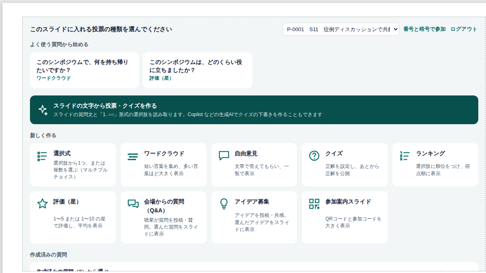
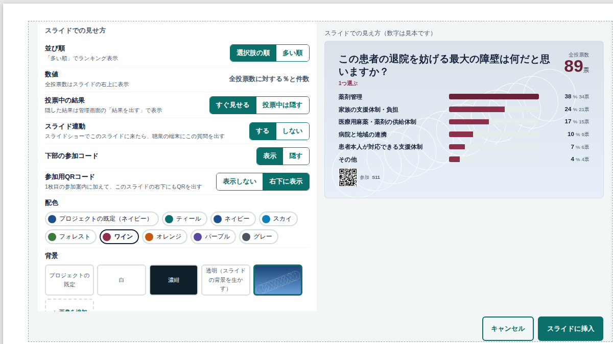

# スライド作成者のための説明書
会場アンケート（リアルタイム投票）を PowerPoint に作り込む手順

この説明書は、シンポジウムのスライドを作る先生方（共同編集者）向けです。
システムの導入や全体管理者の作業は [SETUP_ADMIN.md](SETUP_ADMIN.md) を参照してください。

---

## 0. しくみを30秒で

- 会場の聴衆は、スライドに映した **QRコード** をスマートフォンで読み取り、ニックネームを入れて参加します。
- 発表者がスライドショーで投票スライドに進むと、その質問が **聴衆のスマートフォンに自動で出ます**。
- 聴衆が投票すると、**スライドの中の棒グラフが約2秒ごとに伸びていきます**（スライドに貼るのは画像ではなく、データベースとつながった「窓」です）。

---

## 1. 最初に1回だけ行う準備

### 1-1. アカウントを作る
1. アドイン配布ページのURL（例：`https://○○.github.io/vote/install.html`）を開きます。
2. メールアドレスとパスワード（8文字以上。プロジェクトのパスワードとは別の、ご自分のログイン用）を入れて「この内容で新規登録」を押します。そのままログインされます。

### 1-2. アドインを入れる（配布ページから）
ログインすると、配布ページに Windows 用と Mac 用のダウンロードが表示されます。お使いのパソコンが自動で選ばれます。

**Windows**
1. PowerPoint をすべて閉じる。
2. 「インストーラーをダウンロード」→ `install-vote-addin.cmd` をダブルクリック。
   - 「WindowsによってPCが保護されました」と出たら「詳細情報」→「実行」。管理者権限は不要です（ご自分のユーザーにだけ登録します）。
3. 「完了しました」と出たら閉じる。
4. PowerPoint を開き、「挿入」→「アドイン」→「個人用アドイン」→「投票結果（自前）」を追加。
   - 見つからないときは、配布ページの「うまく表示されないとき（共有フォルダー方式）」の手順で入れてください。
   - 外すときは「アンインストーラー」を実行します。

**Mac**
1. PowerPoint を終了する。
2. 「設定ファイルをダウンロード」→ `vote-addin.xml` が「ダウンロード」フォルダに保存される。
3. 「ターミナル」を開き、配布ページに表示された1行をコピーして貼り付け、return キー（ターミナルを使わない方法もページに記載）。
4. PowerPoint を開き、「挿入」→「アドイン」→「個人用アドイン」→「投票結果（自前）」。

アドインの中身は、配布ページと同じ公開サイト（GitHub）から毎回最新版が読み込まれます。システムが更新されても入れ直しは不要です。

### 1-3. プロジェクトに入る
- **新しく作る（メイン編集者）**：管理画面（`…/admin.html`）の「プロジェクトを作成」。共同編集者に伝えるパスワードもここで決めます。
- **共同編集する（共同編集者）**：メイン編集者から **プロジェクト番号**（例 `P-0001`）と **パスワード** を受け取り、アドインの枠（または管理画面）の「番号とパスワードで参加」に入力します。

メイン編集者と共同編集者は、質問づくり・デザイン・進行・リセットなど**同じ範囲を編集できます**。パスワードの変更と編集者の除外だけはメイン編集者が行います。ほかのプロジェクトは見えません。

---

## 1.5 投票の枠が組み込み済みの PowerPoint を受け取った場合
「1012_医療薬たたき台_修正1_投票組込.pptx」のように、投票の枠があらかじめ入ったファイルを受け取った場合は、2章・3章の作業は不要です。
1. 1章の準備（アカウント・アドイン・プロジェクトへの参加）を済ませる。
2. ファイルを開き、投票の枠があるスライド（例：1・13・17・19・28・29枚目）を**編集画面で一度ずつ表示**する。
3. 枠の中に「ログインしてください」と出たらログインする。参加コードのプロジェクトに自動でつながり、結果の表示に切り替わる。
4. 上書き保存する（つながった情報がファイルに保存される）。

> 枠が「このアドインは使用できません」などと表示される場合は、その枠を削除し、3章の手順で「作成済みの質問を使う」から同じ質問（Q0〜Q4）を選んで入れ直してください。

## 2. 1枚目：参加案内スライドを作る

1. 1枚目（会場で最初に映すスライド）を開きます。
2. 「挿入」→「アドイン」→「個人用アドイン」（Windows は「共有フォルダー」タブ）→「投票結果（自前）」を挿入し、枠をスライドに合わせます。
3. 枠の中でログインし、「参加案内スライド」を選んで「スライドに挿入」を押します。
   - QRコードと参加コード（例 `S11`）が大きく表示されます。
   - 既存のQR画像の代わりに使えます。

QRコードは、**1枚目だけに出す方法**と、**質問ごとのスライドにも出す方法**のどちらでもできます（4章）。

---

## 3. 質問のスライドを作る

1. 質問を出したいスライドで、同じようにアドインを挿入し、枠をスライドに合わせます。
2. 開始画面から作り方を選びます。

| 作り方 | 使う場面 |
|---|---|
| よく使う質問から始める | 「何を持ち帰りたいですか？」「どのくらい役に立ちましたか？」をそのまま使う |
| スライドの文字から投票・クイズを作る | スライドに書いた質問文と「1. ○○」形式の選択肢を読み取り、下書きを作る。Copilot などの生成AIでクイズの下書きを作ることもできる |
| 新しく作る | 下の表の種類から選ぶ |
| 作成済みの質問 | 管理画面や他のスライドで作った質問をこのスライドに出す |

| 種類 | 聴衆の操作 | スライドの表示 |
|---|---|---|
| 選択式（マルチプルチョイス） | 1つ、または複数（最大10）を選ぶ。許可すれば自分で選択肢を追加できる | 全投票数に対する％と件数を横棒で |
| ワードクラウド | 短い言葉を投稿 | 多い言葉ほど大きく |
| 自由意見 | 文章を投稿 | 一覧 |
| クイズ | 1つ（または複数）を選ぶ | 正解を出すと ✓ が付く |
| ランキング | 上位いくつかに順位をつける | 得点順 |
| 評価（星） | 星1〜5（または1〜10） | 平均点と分布 |
| 会場からの質問（Q&A） | 質問を投稿し、他の人の質問に賛同 | 座長が選んだ質問、または賛同の多い順 |
| アイデア募集 | アイデアを投稿し、共感 | 同上 |
| 参加案内スライド | ― | QRコードと参加コード |

3. 設定画面はすべてボタンで操作します。右側に「スライドでの見え方」の見本が出ます。
   - **選択肢**は10件まで。「＋ 選択肢を追加」で増やします。
   - **複数選択**は「複数選べる」を選び、選べる数を −／＋ で指定（最大10）。
   - **回答者による選択肢の追加**を「許可する」にすると、聴衆が「その他」を自分で書いて追加できます（数の上限なし）。
4. 「スライドに挿入」を押すと、質問が作られ（番号 Q1, Q2… は自動）、枠の中に結果表示の窓が入ります。

### スライドショーとの連動
「スライド連動：する」（既定）にしておくと、スライドショーでそのスライドに進んだ瞬間に、聴衆のスマートフォンがその質問に切り替わります。発表者は**スライドを進めるだけ**です。

---

## 4. デザイン：配色・背景・QRコード

| 設定 | 選べるもの |
|---|---|
| 配色 | プロジェクトの既定／ティール／ネイビー／スカイ／フォレスト／ワイン／オレンジ／パープル／グレー |
| 背景 | プロジェクトの既定／白／濃紺／透明（スライド側の背景を生かす）／登録した画像／「＋ 画像を追加」 |
| 文字を読みやすく（背景画像のとき） | 白く薄める／暗く沈める（文字は白になる）／そのまま |
| 参加用QRコード | 表示しない／右下に表示（このスライドにもQRを出す） |

- **プロジェクトの既定**は、管理画面の「デザイン」で決めます（編集者ならだれでも変更可）。各スライドで個別に変えることもできます。
- 背景画像は自動で縮小して保存されます（スマートフォンで撮った写真でも可）。
- 「透明」を選ぶと、PowerPoint のスライド背景（テンプレート）の上に、結果だけを重ねられます。

---

## 5. 会場からの質問（Q&A）を使うとき
- 聴衆はスマートフォンから質問を投稿し、他の人の質問に「賛同」を付けられます。
- 「スライドへの出し方：選んだ投稿だけ」（既定）では、**座長や補助者が選んだ質問だけがスライドに出ます**。選び方は2通りです。
  - PowerPoint の編集画面で、枠の右下「投稿を選ぶ」を押す
  - 管理画面（スマートフォンでも可）のプレビュー欄で「スライドに出す」を押す（スライドショー中はこちらが便利）
- 「賛同の多い順」にすると、上位5件が自動で出ます。

---

## 6. リハーサル（必ず1回）

1. スライドショーを開始し、手元のスマートフォンで1枚目のQRを読み取って参加する。
2. 質問スライドに進み、スマートフォンが自動で切り替わることを確認する。
3. 投票して、スライドの棒グラフが2秒ほどで伸びることを確認する。
4. 終わったら、管理画面の「参加者も含めて全リセット」を押す（編集者ならだれでも可）。

> 動かない場合の予備策：管理画面の「投影：表示中に追従」URLをブラウザの全画面で表示し、スライドと Alt+Tab（Mac は ⌘+Tab）で切り替える。

---

## 7. 本番中の操作（座長・補助者）
管理画面はスマートフォンでも操作できます。

| 操作 | 場所 |
|---|---|
| 次の質問に進む／前に戻る／表示を止める | 管理画面の上部（スライド連動を使わないとき） |
| 投票を締め切る／再開する | 各質問の「締め切る」 |
| 投票中は結果を隠し、議論のタイミングで出す | 「結果を隠す」→「結果を出す」 |
| クイズの正解を出す | 「正解を出す」（自動で締め切り） |
| Q&A の質問をスライドに出す | プレビュー欄の「スライドに出す」 |
| 不適切な投稿を消す | プレビュー欄の「非表示」 |
| 終了後の記録 | 「結果をCSVで保存」 |

---

## 8. よくある質問

**Q. スライドを複製したら、連動がおかしくなった。**
A. 複製したスライドの枠で「設定を変更」→ 保存をやり直してください（スライドの番号を記録しているため）。

**Q. 投票の数字はどう計算している？**
A. 右上の「全投票数」は、入った票の合計です。各選択肢の％は「その選択肢の票数 ÷ 全投票数」です（複数選択でも合計100％）。

**Q. 聴衆の名前はスクリーンに出る？**
A. 出ません。ニックネーム（本名でも可）は管理画面にだけ表示されます。

**Q. PowerPoint ファイルを配布してよい？**
A. 枠の中に投影用の鍵が保存されています。配布する場合は枠を削除するか、PDF にしてから配布してください。
