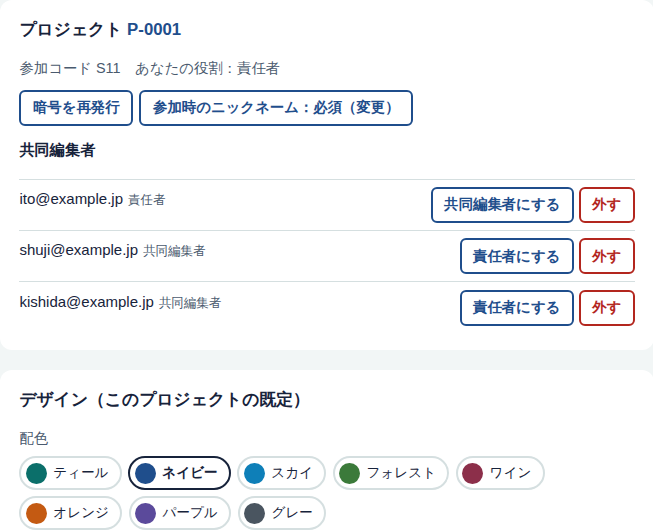

# 導入と管理者・共同編集者の登録（全体管理者向け）

所要時間の目安：初回 1〜2 時間。2つ目以降のプロジェクトは数分。

## 役割

| 役割 | できること | なり方 |
|---|---|---|
| メイン編集者 | 質問づくり・デザイン・進行・締切・リセット・CSV ＋ **パスワードの変更、編集者の除外、メイン編集者の追加** | プロジェクトを作成した人（ほかの人をメイン編集者にすることも可） |
| 共同編集者 | 質問づくり・デザイン・進行・締切・リセット・CSV（**メイン編集者と同じ範囲**） | アカウント登録後、**プロジェクト番号＋パスワード**で参加 |
| 全体管理者（任意） | すべてのプロジェクトの閲覧・編集 | 導入した人が最初に1回「最初の全体管理者として登録」（不要なら登録しなくてよい） |
| 聴衆 | 投票・投稿 | QRコードから参加（ニックネーム必須・本名でも可） |

プロジェクト ＝ PowerPoint ファイル1つ（＝シンポジウム1つ）。プロジェクトごとに、
- **プロジェクト番号**（例 `P-0001`）：自動で付く通し番号
- **パスワード**：作成者が決める（8文字以上）。空欄なら英数字と記号の12文字を自動で作る。データベースにはハッシュ（元に戻せない形）でのみ保存
- **参加コード**（例 `S11`）：聴衆がQRで参加するときのコード

が割り当てられます。**個別の利用許可は不要**で、プロジェクトに入れるかどうかは番号とパスワードだけで決まります。番号とパスワードを知らない人は、アカウントを持っていても、そのプロジェクトの質問・票・投稿を一切見られません（データベースの権限で制御）。

---

## 手順1　Supabase（東京リージョン）を用意する

### 1-1. アカウントとプロジェクトを作る
1. https://supabase.com で「Start your project」→ アカウントを作成（GitHub アカウントでも登録可）。
2. 組織（Organization）を作る。プランは **Free** を選ぶ。
3. 「New project」で次を入力する。
   | 項目 | 入力 |
   |---|---|
   | Project name | 例 `symposium-vote` |
   | Database Password | 自動生成を使い、**必ず控える**（後から表示されない） |
   | Region | **Northeast Asia (Tokyo)**（作成後は変更できない） |
4. 「Create new project」。準備完了まで数分待つ。

### 1-2. データベースを作る
1. 左メニュー「SQL Editor」→「New query」。
2. `supabase/01_schema.sql` の全文を貼り付けて「Run」。「Success. No rows returned」と出れば完了。
   - 以前の版を実行済みでも、新しい版をもう一度実行するだけで更新される（データは消えない）。
3. （任意）サンプルの質問を入れる場合は `supabase/02_seed_symposium11.sql` も実行。

### 1-3. ログインの設定（重要）
Supabase の標準のメール送信は、**Supabase の組織メンバーのアドレスにしか届かず、1時間に2通まで**という制限があります（試験用）。そのため、**確認メールを使わずに、各自がその場でアカウントを作れる**設定にします。

1. 「Authentication」→「Sign In / Providers」（版により名称が異なる）
   - Email：**有効**
   - **Allow new users to sign up：有効**
   - **Confirm email：無効**（確認メールを送らず、登録後すぐにログインできる）
2. 「Authentication」→「URL Configuration」
   - Site URL：`https://<ユーザー名>.github.io/<リポジトリ名>/admin.html`
   - Redirect URLs：`https://<ユーザー名>.github.io/<リポジトリ名>/**` を追加

> **この設定の意味（事実と判断）**：確認メールがないため、登録時のメールアドレスが本人のものかは確かめられません。ただし、アカウントを作っただけでは何も見えず、操作もできません。プロジェクトに入るにはプロジェクト番号とパスワードが必要です。そのため、**パスワードの管理（メールとは別の手段で伝える、漏れたら変更する）が実質的な鍵**になります。
>
> 将来、メールアドレスの確認も行いたい場合は、「Authentication」→「Emails」→「SMTP Settings」で独自のメール送信（例：Gmail のアプリパスワード）を設定し、Confirm email を有効にします。

### 1-4. 接続用の値を控える
「Project Settings」→「API Keys」で次を控える。
| 控える値 | 場所 |
|---|---|
| Project URL | `https://xxxx.supabase.co`（「Data API」または「API」の項） |
| **Publishable key**（`sb_publishable_…`） | 「Publishable and secret API keys」タブ。なければ「Create new API keys」 |
| （代替）anon key（`eyJ…`） | 「Legacy API Keys」タブ。Publishable key で接続できない場合に使う |

**Secret key（`sb_secret_…`）と service_role key は絶対に使わない・公開しない。** 誤って登録すると公開処理が止まるようにしてあります。

## 手順2　GitHub に登録して公開する（このパッケージ）
1. GitHub で新しいリポジトリを作る（例 `vote`。公開リポジトリで可。データはSupabase側にあり、リポジトリには入りません）。
2. このフォルダの中身をすべてアップロードする（`.github` フォルダも含める）。
   - ブラウザの場合：リポジトリの「Add file」→「Upload files」にフォルダの中身をドラッグ。
   - コマンドの場合：`git init` → `git add .` → `git commit -m "初版"` → `git remote add origin …` → `git push -u origin main`
3. リポジトリの「Settings」→「Secrets and variables」→「Actions」→「Variables」に次を登録する。

   | 名前 | 値 |
   |---|---|
   | `SUPABASE_URL` | 手順1-4 の Project URL |
   | `SUPABASE_ANON_KEY` | 手順1-4 の Publishable key（または anon key） |

4. 「Settings」→「Pages」→「Build and deployment」の Source を **GitHub Actions** にする。
5. 「Actions」タブで「公開（GitHub Pages）」を実行（または何かファイルを更新して push）。緑のチェックが付けば公開完了です。
   - このとき、接続設定（`config.js`）が自動で作られます。コードを書き換える必要はありません。
   - アドインの設定ファイルは公開フォルダに置きません。配布ページ（`install.html`）にログインした人のブラウザの中で、Windows 用インストーラーと Mac 用設定ファイルを作ります。
   - 公開URL：`https://<ユーザー名>.github.io/<リポジトリ名>/`
   - 管理画面：`…/admin.html`　アドイン配布ページ：`…/install.html`

## 手順3　（任意）全体管理者を登録する
全体管理者は、すべてのプロジェクトを見渡したい場合だけ登録します（通常の運用には不要）。
1. `…/admin.html` を開き、「この内容でアカウントを新規登録」→ そのままログインされる。
2. 「最初の全体管理者として登録」を押す（全体管理者が1人もいないときだけ表示されます）。
3. 2人目以降の全体管理者が必要な場合は、SQL Editor で次を実行。
   ```sql
   insert into public.admins(user_id, email)
   select id, email from auth.users where email = '追加する人のメール';
   ```

## 手順4　プロジェクトを作り、共同編集者を招く
1. 管理画面にログインし、「プロジェクトを作成」→ プロジェクト名、聴衆の参加コード（英数字。例 `S11`）、**共同編集者に伝えるパスワード**（8文字以上。空欄なら自動）を入力。作成した人が**メイン編集者**になります。
2. **プロジェクト番号とパスワードが表示されます。この画面でだけ表示されるので、控えてください。**
3. 共同編集者に、**アドイン配布ページのURL（`…/install.html`）・プロジェクト番号・パスワード**と、[MANUAL_PPT.md](MANUAL_PPT.md) を送る。パスワードは、メールとは別の手段（電話・SMS など）で伝えるのが安全です。
4. 共同編集者が配布ページで新規登録 → アドインを入れる →「番号とパスワードで参加」すると、管理画面の「編集者」欄に表示されます。



| 操作 | できる人 | 場所 |
|---|---|---|
| パスワードの変更（漏れた・人が替わった） | メイン編集者 | 「パスワードを変更」。古いパスワードでは新しく参加できなくなる（参加済みの人はそのまま） |
| 編集者を外す／メイン編集者にする | メイン編集者 | 編集者欄のボタン |
| 聴衆のニックネームを必須／任意にする | 全員 | 「参加時のニックネーム」（既定は必須） |
| プロジェクトの既定デザイン | 全員 | 「デザイン」（配色8種・背景画像・文字の読みやすさ） |

- パスワードの総当たり対策として、1人あたり1時間に10回まで失敗すると、それ以上は受け付けません。
- 外した編集者は、パスワードを変更しない限り同じパスワードで再参加できます。外す場合は、あわせてパスワードを変更してください。

## 公開範囲についての注意（事実）
GitHub Pages は誰でも閲覧できる公開サイトです。画面のプログラム（`addin.html` など）自体は、URLを知っていれば開けます。
ただし、**質問・票・投稿・プロジェクトの読み書きはすべてデータベース側で「そのプロジェクトの編集者か」を判定**しており、プロジェクト番号とパスワードで参加していない人が画面を開いても、何も表示・操作できません。

## 手順5　PowerPoint 側（スライド作成者）
[MANUAL_PPT.md](MANUAL_PPT.md) のとおり。アドインは公開サイトから毎回読み込まれるので、GitHub を更新すれば全員の PowerPoint に自動で反映されます。

## 本番前チェックリスト
- [ ] 発表に使うPCで、スライドショー中に棒グラフが伸びることを確認した
- [ ] 会場Wi-Fiとスマートフォン回線の両方で参加できた
- [ ] リハーサルの票と参加者を「参加者も含めて全リセット」で消した
- [ ] 不要になった編集者を外し、パスワードを変更した（必要な場合）
- [ ] 動作確認用の質問（`TEST` など）を削除した
- [ ] 予備策（ブラウザ全画面の投影URL）を控えた
- [ ] Supabase 無料プランの場合、本番前日に一度アクセスした（7日間アクセスがないと一時停止されるため）
